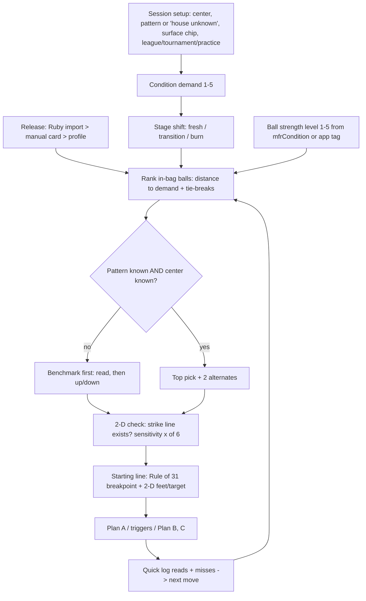

# Arsenal Pro Command Center — Plan

Status: **proposal**, 2026-10-23. Docs only; no app code is changed by this document.

**Labels.**
- **F** = fetched and read in full.
- **S** = search excerpt only.
- **A** = assumption or team rule (editable, never shown as fact).
- **UNKNOWN** = not known; it stays flagged in the UI.

**Builds on:**
- `ARSENAL_MANAGER_PLAN.md` (AM);
- `ROADMAP_NEXT.md` (N0–N4);
- `FEATURE_DEMAND_RESEARCH.md`;
- `IMPORTS_RESEARCH.md`;
- `DESIGN_SYSTEM.md`;
- `DEFLECTION.md`;
- the physics workspace (`/workspace/physics`: `report-v4.md`, `engines/patterns.json`, `ball_specs.csv`).

**Owner answers, 2026-10-23, applied throughout:**
- The owner bowls with **LaneTrax** and **LaneTalk** and owns a **Ruby** sensor.
- The app is **free, with no monetization work**.
- The Ruby CSV is therefore the first import preset. It waits for one real sample file from the owner.
- Once imported, Ruby release data becomes the **primary source for release inputs**.

**North star.** One home screen answers three questions in coach voice, with numbers first:
1. **What do I throw tonight?** Ranked ball pick, starting line and transition plan, each with its "why".
2. **Where do I stand?** Bag, ball health and tonight's score and spares.
3. **What do I move to next?** The next ball down or up, the next feet move, and the next service.

> "Big Bite first. 41 ft medium, fresh pair: benchmark reads it. Breakpoint 10 (Rule of 31)."
>
> This is a template. The real numbers come from the pattern and the bag.

---

## 0. What we learned from best-in-class decision tools

| Tool | What it does | What we take | Label |
|---|---|---|---|
| **Arccos Smart Distances** | "Normalized and adjusted to filter out the outliers"; "Mishits … are automatically detected and excluded"; shows a "Smart Range", where "a narrower range is indicative of more consistent shot performance"; lets you "Exclude Shots" and "Compare Clubs … to optimize your bag composition". | Personal per-ball reads come from **your logged shots**, with outliers excluded and the spread shown. "Data-driven vs ego-driven" ball choice. | F |
| **Arccos Caddie** | Recommends a club from personal data plus conditions. Shows a "Plays Like" distance next to the raw number. Has a tournament mode. | Show the **raw pattern** next to the **"plays like" condition**: pattern + stage + lane surface. Competition mode hides anything not allowed (sensors, A). | S (FAQ excerpt) |
| **Trackman Map My Bag / gapping guides** | Measures each club's carry. At least 6 shots per club, 30 recommended. The guides look for **overlaps** (two clubs carrying the same) and **holes** (no club for a common distance). Gaps need not be equal. | The bag builder flags **overlap** (two balls in the same cell) and **holes** (an empty step between filled steps). It never demands equal steps. A per-ball read needs a minimum n. | S |
| **F1 strategy (Raceteq)** | Strategy starts from "tyre behaviour and pit loss". Simple tyre model: "base pace", "degradation" and "tyre life". Plan A / Plan B. "A simulation is only as accurate as its models". | Transition plan = **Plan A** (starting ball and line), then **trigger** (what you see), then **Plan B / C** (move or ball change). Model output is shown as a model, never as certainty. | F |
| **DFS lineup optimizer (FantasyPros)** | Optimizes from projections. You can "lock in specific players" or "exclude players". | Bag builder: **lock** a ball (always packed) and **exclude** it (benched, pro shop). Rerun instantly and show what changed. | F |
| **Storm reaction charts / buyer's guide** | Axes: flare, ball shape (smooth vs angular), hook length (early / midlane / late), oil volume (light / medium / heavy), pattern length, and lane condition (fresh, transition, burn). "Heavy oil … aggressive coverstocks"; burn → "low flare potential and later hook shapes". | Our ranking axes and the **fresh → transition → burn** stage model. | F |
| **Benchmark logic (Motiv, BTM, bowl.com)** | The benchmark is "never the strongest or the weakest ball", is "the first ball out of the bag at a tournament, on a new pattern, or in a new bowling center", and "too smooth … more angular ball, too weak means grab a stronger ball … too angular … smoother selection" (Motiv F). It "will tell you if you need something stronger or weaker, smoother or sharper" (BTM F). Rule of 31, length bands, and "as the lanes break down, switching to a weaker ball" (bowl.com F). | The **benchmark-first** rule, the up/down/smoother/sharper read buttons, the starting breakpoint and the transition direction. | F |
| **6-ball arsenal guides** | Roles: strong asym solid, control/urethane-type, benchmark, cleaner asym, clean sym pearl, spare. "Avoid using balls with the same core or overall ball motion shape". Speed-dominant players carry more asym; rev-dominant players carry more sym; matched players carry 3/3. | Bag templates and the overlap rule. | F (Bowler's Review) |
| Other arsenal guides | 4-ball and 6-ball tiers (bowlingballvideos); "tournament bowlers: fill at least 5 categories" (bowling.com); urethane for short/flat patterns (TenPin Tourney). | Template variants only. | S |
| Storm strong/medium/weak × smooth/sharp grid (YouTube categorization, "Chris Barnes" system) | A 2-axis grid that keeps you from "buying the same bowling ball twice". | The coverage grid shape. Placement is opinion (S), so it is never imported as data. | S |

---

## 1. What we need (inputs)

Status key:
- **Have**: usable today.
- **Partial**: some data, gaps flagged.
- **Missing**: none yet.

| # | Input | Status | What exists today | Source | How we get the rest |
|---|---|---|---|---|---|
| 1 | **Ball specs** (RG, diff, cover, core sym, factory finish, mfr condition) | **Partial** | `js/data.js`: 22 balls, **7 spec TBD**. `ball_specs.csv`: 145 rows; RG/diff on 111; `mfr_condition` on all 145. | data.js `link` per ball; bowlingballvideos catalog (physics `research.md`) | Manufacturer card or page (F), recorded per field (`src` in AM §1.1). TBD stays TBD. Never fill from similar balls. |
| 2 | **Ball oil tags / role** | **Partial** | data.js `oil[]`, `role`, `when`, `whenNot` are **app editorial**, not manufacturer data. | app authors (A) | Show as "app tag". Prefer `mfrCondition` when present. The user can edit. |
| 3 | **Owned balls + status** (in bag / benched / pro shop / retired) | **Missing** | `profile.owned` (ids only). `BAGS` presets are hard-coded. | — | AM P1 `ap_owned` + onboarding: confirm owned balls (defaults to none). |
| 4 | **Layout / PAP at drill** | **Missing** | free-text PAP in profile | — | Pro-shop drill sheet → typed in (AM P4). Ruby lists PAP (F, `IMPORTS_RESEARCH`). |
| 5 | **Surface history** (current grit) | **Partial** | `ap_surface` `{ballId,date,finish}`; finish preset in sim | user | AM events (`refresh`/`resurface`). Unknown → "factory (assumed)", labelled A. |
| 6 | **Games / usage per ball** | **Missing** | shots log `ap_shots` (miss type, ball, preset pattern) | user | N1 scoring (`ap_games`) with a ball tag per game. Optional LaneTalk GDPR export (below). |
| 7 | **User's release** (speed, rev, tilt, rotation, PAP, launch angle) | **Partial** | `ap_profile`: hand, style, speed, rev, PAP and tilt (optional free text). **No axis rotation field.** Sim defaults 15 mph / 220 rpm are app defaults, not measurements. | user-typed | **Ruby CSV import (primary once imported):** Ruby lists RPM, Spd, PAP, Tilt, Rot (F). Column names UNKNOWN until the owner shares one export. Until then, the manual release card (N0) with source "Ruby (typed)". |
| 8 | **Pattern: length / volume / ratio** | **Have** (volume **partial**) | `data/patterns-index.json`: 709 patterns. ft and ratio on 709; mL on 443. Steps on demand. | Kegel Pattern Library via CarryDown | **Tonight's house shot is UNKNOWN.** Ask the center for the pattern name or sheet. Otherwise choose "house shot – unknown" (benchmark-first rule, §2). |
| 9 | **Lane surface** (wood / synthetic, topography) | **Missing** | — | bowl.com: wood hooks more/earlier, synthetic is tighter (F) | One chip per center: wood / synthetic / unknown. Topography: UNKNOWN and not planned. |
| 10 | **Transition data** (how the lane changes over games) | **Partial** | shots log (Left/Right/High/Light). 3-D `transition4` exists but **engine v4b is QA-blocked (5/10)**. | physics `report-v4.md` | Personal: games-into-session + misses from N1. Measured: **LaneTrax** boards (arrows, breakpoint, entry; F) via manual entry from its PDF. Model: only after the physics QA gate passes. |
| 11 | **Scoring / pin leaves** | **Missing** | — | — | N1 scoring pad. LaneTalk has no user export (F, competitor claim): **GDPR export or manual entry**. |
| 12 | **Spare system** | **Have** (rules) / **Missing** (personal data) | USBC 3-6-9 table (RH: 2/8→17, 4→14, 7→11, 3/9→23, 6→26, 10→29 from strike board 20; LH mirrored) | USBC PDF (F, `FEATURE_DEMAND_RESEARCH.md`) | Personal conversion % from N1 leaves. Strike position from tonight's line. |
| 13 | **Sensor / tracker imports** | **Missing** | — | `IMPORTS_RESEARCH.md` | 1) **Ruby CSV** preset once a sample is held. 2) **LaneTrax PDF** parse (layout UNKNOWN) plus manual entry; LaneTrax CSV is on their roadmap (F). 3) **LaneTalk** GDPR file or manual entry. Witsee/F5 not planned (owner does not use them). |
| 14 | **Event context** (league 3-game vs tournament block, pair moves, date) | **Missing** | — | — | One-tap session setup: league / tournament / practice + games planned. |
| 15 | **Ball health** (games since service) | **Missing** | — | AM §1.4 cited intervals | AM P1–P2. |

**Summary:**
- **Have:** 2 (pattern library, 3-6-9 rules).
- **Partial:** 5 (ball specs, oil tags, surface history, release, transition).
- **Missing:** 8 (owned balls/status, layouts, games, lane surface, scoring, imports, event context, ball health).

Pattern volume is partial inside "have".

**Top 3 missing inputs and how to get them:**
1. **Measured release** (tilt, rotation, PAP, speed, rev): the owner's **Ruby CSV**. We need one real shot/session export to build the preset. Until then, the manual release card.
2. **Owned balls, status and surface/usage history**: AM onboarding plus quick log (≤ 2 taps), and the pro-shop drill sheet for layouts.
3. **Tonight's pattern and lane surface, plus game/spare results**:
   - ask the center for the house-shot name or sheet, and set a wood/synthetic chip;
   - N1 scoring for leaves;
   - LaneTrax PDF boards for measured breakpoint and entry.

---

## 2. Decision logic (transparent ranking)

### 2.1 Principles
- **Explainable over clever.** Every ranked ball shows 2–4 **why-lines**, each with its source label. There is no hidden score; tapping "Why" shows the arithmetic.
- **Rules first, model second, your data third.**
  - Cited rules give the order.
  - The 2-D model checks that a strike line exists.
  - Your own logged reads take over once n ≥ 10 (Arccos-style, outliers excluded, spread shown).
- **Never invent.** A ball with spec TBD is ranked only on tags, labelled "spec TBD", and never gets a model line.

### 2.2 Flow



### 2.3 Steps

**Step 1. Condition demand, 1–5** (Dry/Light → Heavy, the same scale as `mfr_condition`).
- **Pattern length band** (bowl.com F): ≤ 36 ft short, 37–42 medium, ≥ 42 long.
- **Volume:** the pattern's mL **tertile within the 709-pattern library**. This is derived from data, not a magic number. If mL is unknown (266 patterns), use "volume unknown" and length only.
- **Mapping band × tertile → 1–5** is a **team rule (A)**, shown in "Why" and editable. Its direction is cited: more volume/length → stronger, earlier ball (Storm buyer's guide F).
- **Lane surface:** wood → −1 suggestion, synthetic → 0, unknown → 0 with a flag (bowl.com F for direction; size A).

**Step 2. Stage shift.**
- **Fresh** → 0; **transition** → −1; **burn** → −2. Direction is from Storm F and bowl.com F; the step size is A.
- The stage is user-tapped. Its default comes from games bowled on this pair tonight (A). It is replaced by **your** history: "your Plan B usually came in game 2" (n ≥ 10 sessions).

**Step 3. Ball strength level, 1–5.**
- Use `mfrCondition` if it has a source. Otherwise use the app `oil[]` tag (labelled "app tag").
- Within a level, order by cover (solid > hybrid > pearl > urethane/plastic). Then use the current surface: duller = earlier (Bowler's Review F: "Sanded finishes read earlier, while polished surfaces create more length").
- RG and diff are shown in the why-lines and used only as tie-breaks (lower RG = earlier; higher diff = more flare). Only `specOK` balls take part in these tie-breaks.

**Step 4. Rank in-bag balls by |ball level − demand|. Then tie-breaks, in order:**
1. **Benchmark first** if the pattern is unknown, the center is new, or it is the first game of a tournament block (Motiv F, BTM F).
2. Shape fit by player type (Bowler's Review F). The app `style` field is used as a proxy (A):
   - stroker → speed-dominant → asym;
   - cranker → rev-dominant → sym;
   - tweener → neutral.

   Ruby speed/rev replace the proxy once imported.
3. **Your data:** this ball's logged reads on this pattern or center (strike %, misses). Used only at n ≥ 10 shots, with outliers excluded and the spread shown.
4. **Health:** an overdue ball is not demoted; it gets a "due" badge and a line ("58/60 games · Brunswick", AM §1.4).
5. Balls with status proShop/retired are excluded. A **locked** ball is always shown.

**Step 5. Output: top pick + 2 alternates (one weaker, one stronger).** These are the "up" and "down" buttons in physical form.

**Step 6. Read buttons** (after a few practice shots). Each moves the pick one step:

| Read | Next |
|---|---|
| Too early / hooks too much | Weaker / later |
| Too weak / skids too far | Stronger |
| Too angular | Smoother |
| Too smooth | More angular |

This is Motiv's benchmark logic (F), shown as 4 large buttons.

**Step 7. Starting line.**
- Breakpoint board = pattern ft − 31 (bowl.com F). For long patterns (≥ 42 ft) also show bowl.com's "13–16 boards" band. When the two disagree, say so; never pick silently.
- The **2-D model** (`js/engine.js`) searches aim × release for a `STRIKE` (entry 17.5 ± 0.7, angle 4–6°). It uses the user's speed/rev/finish and the **nearest of the six presets by length**, the same approximation the Pattern screen already discloses.
- Output: feet board, arrows target, model breakpoint and `sensitivity()` "x of 6". Labelled **"2-D model estimate"**. Mirrored for LH.

**Step 8. Transition plan (F1 style):**
- **Plan A** = pick + line.
- **Triggers:** 2 of the last 3 shots "High" → feet and eyes left (RH), using `coachLine` move sizes. 2 of 3 "Light" → right / stronger. Read "Too early" ×2 → Plan B ball (weaker). The trigger counts are A, editable.
- **Plan B / C** = the next weaker ball(s) in the bag with their own Rule-of-31 line. bowl.com F: "as the lanes break down, switching to a weaker ball".
- **No predicted board counts per game** until the 3-D engine passes QA.

### 2.4 What uses the 2-D model today vs what waits for the 3-D engine

| Capability | Today (2-D `engine.js`, `deck.js`) | Waits for 3-D oil/transition engine v4b (QA-blocked 5/10: 3/709 breakpoints < 30 ft on short/low-volume patterns, CV fold variance, urethane ordering wrong, absorption not identifiable) |
|---|---|---|
| Strike line exists for ball + release | ✅ Six presets by length; disclosed as approximate | Real pattern oil grid per slug |
| Feet / target / breakpoint | ✅ Model estimate + Rule of 31 | Per-ball breakpoint on the exact pattern |
| Pin-deck carry / leave preview | ✅ `deck.js` deflection (DEFLECTION.md) | — |
| Ball ranking | ❌ Not used (rules rank; model only verifies) | Optional model ordering, only after the urethane-ordering fix |
| Transition ("move N boards by game 2") | ❌ Rules + your logs only | `transition4` (worst 15-shot jump 0.71 bd passed), but shown only behind a flag after the full QA gate |
| Surface / grit effect | Finish multiplier (existing, coarse) | `surface.py`; all its numbers are ASSUMED today, so it stays off |

**Feature flag:** `cc3d` stays **off**. It turns on only when the physics report shows QA ≥ 9/10 with the sweep passing. Ruby and LaneTrax measured-vs-predicted (N3) is the calibration input.

---

## 3. Bag builder rules

**Formats:**
- **League 3** (app `BAGS`): Benchmark, Cleaner pearl, Spare. Alternative "Tighter lanes": Strong, Benchmark, Spare.
- **League 4** (S, bowlingballvideos): adds a stronger ball above the benchmark.
- **Tournament 6** has two templates:
  - (a) the app's current `BAGS`: Benchmark, Strong solid, Strong hybrid, Cleaner pearl, Control/transition, Spare;
  - (b) Bowler's Review F: Strong asym solid, Control/urethane-type, Benchmark, Cleaner asym, Clean sym pearl, Spare.
- **Custom.**

**Coverage grid.**
- Rows: strength level 1–5 (§2 step 3).
- Columns: shape, smooth ↔ angular. The proxy is core symmetry + diff + cover; it is **A** because there is no manufacturer shape spec for most balls. The UI says "shape (estimate)".
- Cells show in-bag balls filled and benched balls outlined. The four named AM gaps appear as dashed slots (AM §2.5).

**Checks.** All are warnings and never block, so the user stays in charge:
1. **Exactly one benchmark**, and it sits in the **middle** (never the strongest or weakest; Motiv F). A missing benchmark is a warning.
2. **Spare ball present** in tournament 6 (all sources F/S). League 3 also includes one (app preset).
3. **Overlap:** two balls in the same cell, or the same core family + same cover type. Bowler's Review F: "avoid … the same core or overall ball motion shape".
4. **Hole:** an empty strength level between the strongest and weakest packed ball (Trackman/gapping analogy, S). Bowling has no equal-gap rule, so only holes and overlaps are flagged.
5. **Pattern fit** (when an event pattern is set):
   - at least one ball within ±1 of fresh demand;
   - one ball for transition (demand −1);
   - one for burn (demand −2).
6. **Sym/asym mix by player type** (Bowler's Review F; uses the proxy until Ruby).
7. **Control option** for short or flat patterns (Bowler's Review F). Flat is ratio-based, using the ratio from the library. Threshold A, editable.
8. **Health:** due before `eventDate` → "Service before {date}" (AM).
9. **Status:** proShop/retired is blocked from the pack list with a reason.
10. **USBC approved list:** "check" when the name does not match (AM).

**Interaction (DFS style):**
- **Lock** / **Exclude** per ball.
- "Fill bag" proposes a bag with the fewest overlaps and holes from owned balls only, and shows a diff vs the current bag.
- Swap in ≤ 2 taps (AM target).
- **No purchase links.** Gaps list catalog candidates that match the criteria, with source labels, as information (AM non-goal: no affiliate).

**Output:** a pack list (role → ball → why), "Service before {date}" items, and the spare ball.

---

## 4. Screen design

Mobile-first at 360 px:
- Honey Badgers tokens (`--forest #0F4D34`, `--gold #DAAF37`, `--black`; dark surfaces);
- 44 px tap targets;
- tabular numerals (`.num`);
- coach voice: ≤ 2 sentences, number or ball first;
- all motion off under reduced-motion.

**Command Center** ("Tonight") becomes the default tab once a bag exists. Until then, the onboarding card says: "0 balls in your bag. Add your bag to get a pick."

```
┌──────────────────────────────┐  360 px
│ TONIGHT  ·  League · Game 1   │  forest header, gold accent
│ [Pattern: House – unknown ▾]  │  chip → pattern library / "ask center"
│ [Wood ▾] [Fresh|Trans|Burn]   │  surface chip, stage segmented
├──────────────────────────────┤
│ ① THROW                       │
│  ● Rattler Big Bite   BENCH   │  gold dot = pick
│  "Benchmark first. Pattern    │  coach line (≤2 sentences)
│   unknown: read, then move."  │
│  why ▸ medium tag (app) ·     │  why chips w/ F/S/A labels
│        new center → bench (F) │
│  ◀ weaker: Hy-Road Pearl      │  alternates = down / up
│  ▶ stronger: Super Nova       │
│  [Too early][Too weak]        │  read buttons (Motiv logic)
│  [Too sharp][Too smooth]      │
├──────────────────────────────┤
│ ② LINE   2-D model estimate   │
│  Feet 20 · Arrows 12 · BP 9   │  (template numbers)
│  Rule of 31: 40 ft → board 9  │
│  Holds: 4 of 6   [See lane ▸] │  sensitivity(); opens lane.js
├──────────────────────────────┤
│ ③ PLAN  A ▸ B ▸ C             │
│  A Big Bite @ 20/12           │
│  B if 2/3 High → 2L 1L        │
│  C Hy-Road Pearl, BP 8        │
├──────────────────────────────┤
│ ④ SPARES (3-6-9 from 20)      │
│  10→29  7→11  6→26  4→14 …    │  mirrored LH
├──────────────────────────────┤
│ ⑤ BAG  3 in · 1 bench · 1 shop│
│  ⚠ Big Bite 58/60 · Brunswick │  due badge (AM)
│  [Bag builder ▸]              │
├──────────────────────────────┤
│ X  /  –  O  [leave grid] Ball▾│  sticky quick log, 1–3 taps
└──────────────────────────────┘
```

**Bag builder:**

```
┌──────────────────────────────┐
│ BAG  Tournament 6 ▾  Sat 11/7 │
│ strength ▲   smooth ··· angular│ (shape = estimate)
│ 5 Heavy   [Super Nova]  [ ]   │
│ 4         [C4]          [- -] │ dashed = gap
│ 3 Medium  [Big Bite★]   [ ]   │ ★ benchmark (middle)
│ 2         [Hy-Rd Pearl] [ ]   │
│ 1 Light   [Deadly R.]   [ ]   │
│ Spare     [Ice Storm]         │
│ ⚠ Overlap: none · Hole: none  │
│ ⚠ Service before 11/7: 1 ball │
│ 🔒 lock / ⨯ exclude per ball  │
│ [Fill bag] [Pack list]        │
└──────────────────────────────┘
```

The ball positions above are illustrative; real placement comes from §2 step 3.

**States:**
- **Offline:** everything works; nothing needs the API.
- **Spec TBD ball:** grey "spec TBD", no model line.
- **Sensor data:** a "practice" tag plus the USBC note (ES Manual F); never shown as legal in competition.
- **Empty:** one action per card.

---

## 5. Phased build, slotted into `ROADMAP_NEXT.md`

| Phase | Ships with | Scope | Measurable targets |
|---|---|---|---|
| **CC0 Tonight shell** | N0 | Session setup (pattern from library or "house unknown", surface chip, stage); rank from `profile.owned`/`BAGS` with why-lines; Rule of 31 from the **real pattern ft**; 2-D line check; manual release card (source "Ruby (typed)"). | Card renders < 1 s at CPU 4× throttle, offline (A). **≥ 20 golden scenarios** (pattern × stage × bag) give the expected order, signed off by the Research Steward against cited rules. 100% of ranked balls show ≥ 2 why-lines with labels. 0 model lines for spec-TBD balls. |
| **CC1 Quick log + spares + Plan A/B** | N1 | Sticky quick log (strike 1 tap, spare ≤ 3); read buttons; triggers → Plan B/C; 3-6-9 panel from tonight's strike board. | Read → new pick in ≤ 1 tap. Triggers unit-tested (High/Light sequences). 3-6-9 matches the USBC PDF for all 10 key pins × RH/LH. 0 throws lost on tab kill. |
| **CC2 Bag builder + arsenal status** | N2 (AM P1–P3) | `ap_owned`/`ap_bags`; coverage grid; checks 1–10; lock/exclude; fill bag; pack list; status strip with due badges. | Swap ≤ 2 taps. Overlap/hole detection tests (≥ 12 fixtures). Status/health counts equal the event log (test). "Fill bag" uses owned balls only (test). |
| **CC3 Measured release + personal reads** | N3 | **Ruby CSV preset** (once a sample is held) becomes the primary release source. **LaneTrax PDF** parse (once a sample is held) + manual board entry. **LaneTalk** GDPR file or manual. Personal reads per ball/pattern; predicted-vs-measured boards. | No preset without a fixture in `tests/fixtures/`. Every imported value shows source + n + median + IQR. No suggestion when n < 10. Predicted-vs-measured error published in `docs/`. Ruby values never auto-apply (user confirms). |
| **CC4 Tournament mode + 3-D (gated)** | N4 + physics gate | Event date; block/pair stage; bag preview per stage; `cc3d` flag only after physics QA ≥ 9/10 with the sweep passing. | Tournament mode hides sensor suggestions (A, USBC). With the flag off, the 3-D output is unreachable (test). With it on, the per-pattern error is shown next to the prediction. |

**QA gate:** `ROADMAP_NEXT.md` §3 applies to every CC phase (e2e green, axe, 360/390/768/1280, XSS, offline, data honesty, CSP, coach copy, reviewer 10/10), plus:
- **Explainability:** every recommendation can be reproduced from its why-lines (test recomputes the order).
- **No silent fallback:** when a rule conflicts (Rule of 31 vs band), both are shown.

---

## 6. Non-goals
- No monetization, ads or affiliate links (owner: free for now).
- No cover-life % and no copying BTM charts.
- No accounts.
- No scraping LaneTrax/LaneTalk.
- No reverse-engineering Ruby's app or BLE.
- No "best ball to buy" ranking.

## 7. Questions for the owner
1. What is the house shot at your center (name, or length/volume from the center), and are the lanes wood or synthetic?
2. Which balls do you own today, and which are in the bag, benched or at the pro shop? Is Big Bite still your benchmark?
3. Can you share **one Ruby CSV** (shot, session or full-day) and **one LaneTrax PDF**? Would you request a LaneTalk GDPR export?
4. Layouts / PAP from your drill sheets?
5. League format (3 games, pair moves?) and any tournament dates for the bag builder?

## Sources

**Fetched (F) in this task:**
- Motiv, "What is a benchmark ball", motivbowling.com/blog/what-is-a-benchmark-ball.html
- Bowling This Month, "The Benchmark Ball", bowlingthismonth.com/quick-tips/the-benchmark-ball/
- USBC BOWL.com, "Reading the Lane", bowl.com/reading-the-lane
- Storm, "New Reaction Charts", stormbowling.com/read/storm-bowling-s-new-reaction-charts-empower-bowling-ball-selection
- Storm, Buyer's Guide, stormbowling.com/bowling-ball-buyers-guide
- Bowler's Review, "How to Build Six Ball Arsenal", bowlersreview.com/instruction/how-to-build-6-ball-arsenal
- Arccos, Smart Club Distances, arccosgolf.com/pages/smart-club-distances
- Raceteq, "How F1 teams determine the fastest race strategy" (2024-07-04)
- FantasyPros support, "How does the DFS Lineup Optimizer work?"

**Search excerpts (S):**
- Arccos Caddie FAQ
- Trackman Map My Bag (help center)
- MyGolfSpy gapping
- MG Golf gapping
- Tamer Bowling benchmark
- National Bowling Academy
- bowlingballvideos.com arsenal guide
- bowling.com knowledge hub
- TenPin Tourney
- Bowler's Review tournament arsenal
- YouTube "2026 Storm Bowling Ball Guide" categorization
- DFS Hero / Martian Flow exposure docs

**Inherited (labels as in those docs):**
- USBC 3-6-9 PDF and USBC ES Manual (F, `FEATURE_DEMAND_RESEARCH.md`)
- Ruby App Store and rubybowling.com, LaneTrax listing and ToS, LaneTalk via LaneLogic (`IMPORTS_RESEARCH.md`)
- Kegel Pattern Library via CarryDown (pattern data)
- physics `report-v4.md` (engine QA status)
